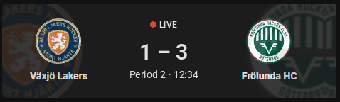
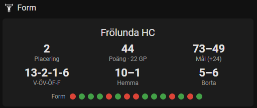
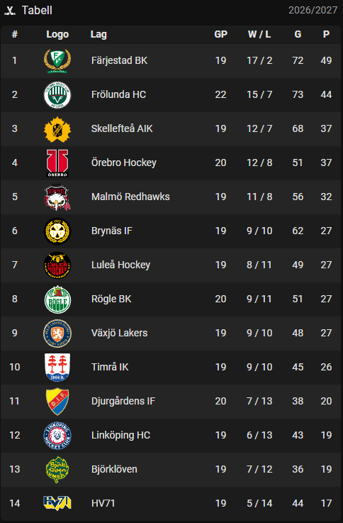
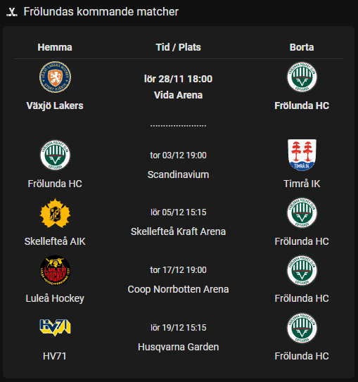
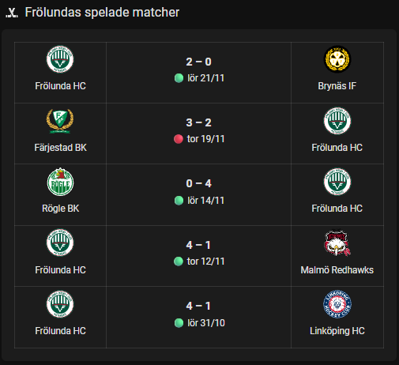

# SHL 🏒 Swedish Hockey League (unofficial)

A Home Assistant integration that shows games, results and standings from the Swedish Hockey League (SHL) for your favorite teams.

> [!IMPORTANT]
> This integration is **not affiliated with or endorsed by SHL**. It uses shl.se's public but **unofficial** API, which may change or stop working at any time. All data belongs to SHL and is shown as shl.se publishes it – if a score, a goal or a time is wrong or late, it is wrong or late at shl.se too.

<p align="center">
  
  
</p>
<p align="center">
  
  
  
</p>

<sub>Example dashboard built with Markdown, button-card and flex-table cards using this integration's sensors. The cards themselves are not part of the integration – see [Examples](#examples).</sub>

## Features

- Pick one or more favorite teams.
- Next game, last result and table position per team.
- The full standings table.
- Adaptive polling: data is fetched often only when your teams play.
- Follows your Home Assistant language and date/number format.
- Handles season changes and playoffs automatically.
- Optional live updates: score, period and a goal event while your teams play (off by default).

## Installation

### Marketplace (recommended)

1. Go to **Settings → Marketplace → Custom repositories**.
2. Add `https://github.com/Lavve/ha_shl-hockey` with the type **Integration**.
3. Find **SHL 🏒 Swedish Hockey League (unofficial)** and install it.

### Manual

Copy `custom_components/shl` to `config/custom_components/shl` in your Home Assistant configuration folder and restart Home Assistant.

## Setup

[](https://my.home-assistant.io/redirect/config_flow_start/?domain=shl)

Or go to **Settings → Devices & services → Add integration** and search for **SHL**. Select your favorite teams. You can change them later with **Configure**.

## Entities

Each favorite team gets its own device with a calendar, four sensors, a goal event and a live updates switch. Entity IDs below use Frölunda HC as an example.

| Entity                            | State          | Description                                                                                                                              |
| --------------------------------- | -------------- | ---------------------------------------------------------------------------------------------------------------------------------------- |
| `calendar.frolunda_hc_games`      | –              | Every game this season, with the score once played.                                                                                      |
| `sensor.frolunda_hc_next_game`    | Start time     | The next or ongoing game.                                                                                                                |
| `sensor.frolunda_hc_last_game`    | Result         | `win`, `loss`, `overtime_win`, `overtime_loss`, `shootout_win` or `shootout_loss`.                                                       |
| `sensor.frolunda_hc_position`     | Number         | Position in the standings.                                                                                                               |
| `sensor.frolunda_hc_games_played` | Number         | Games played this season. All of the season's games in the `games` attribute. Disabled by default – enable it on the team's device page. |
| `event.frolunda_hc_goal`          | Last goal time | Fires `goal_for` when the team scores and `goal_against` when the opponent does. Only with live updates on.                              |
| `switch.frolunda_hc_live_updates` | `on`/`off`     | Live updates for the team's games. Off by default. Found under **Configuration** on the device page.                                     |

The **SHL** device has the standings and the live delay:

| Entity                  | State                    | Description                                                                 |
| ----------------------- | ------------------------ | --------------------------------------------------------------------------- |
| `sensor.shl_standings`  | Season, e.g. `2026/2027` | The full table in the `table` attribute.                                    |
| `number.shl_live_delay` | Seconds, `0`–`300`       | Holds all live updates back. `0` by default. Found under **Configuration**. |

### Attributes

**Next game:** `status` (`upcoming`, `in_progress`), `opponent`, `opponent_logo`, `home_game`, `venue`, `home_team`, `away_team`, `home_logo`, `away_logo`. With live updates on, while the game is played: `home_score`, `away_score`, `live_state` (`ongoing`, `period_break`, `overtime`, `shootout`, `ended`), `period` and `clock` (time played in the period, e.g. `07:12`).

**Goal event:** `team` (the scoring team), `home_team`, `away_team`, `home_score`, `away_score` (after the goal), `scorer`, `assists` (a list), `period`, `clock` and `strength` (as SHL reports it, e.g. `EQ`, `PP1`, `SH1`).

**Last game:** `start`, the same game attributes as above, `home_score`, `away_score`

**Position:** `points`, `games_played`, `wins`, `overtime_wins`, `overtime_losses`, `losses`, `goals_for`, `goals_against`, `goal_difference`

**Games played:** `games` – all of the team's games this season, played and upcoming, oldest first. Each game has `start`, `game_type` (`regular`, `playoff`, `qualdown`), `played`, `result` (as for the last game, `null` if not played), `home_game`, `home_code`, `away_code`, `home_team`, `away_team`, `home_logo`, `away_logo`, `home_score`, `away_score` and `venue`. The list is not saved in the recorder database.

**Standings:** `source` (`official`, or `calculated` while SHL's own table has not yet caught up with the latest results), `table` – a list with one item per team containing `rank`, `team_code`, `name`, `logo` and the same numbers as the position sensor. The table is not saved in the recorder database.

Wins and losses (`wins`, `losses`) are in regulation time. Overtime and shootout results are counted in `overtime_wins` and `overtime_losses`.

Team logos are linked from shl.se, not included in this repository.

## Examples

Ready-to-copy dashboard cards and automations are in the [examples](examples/) folder:

| Example                                                                              | Shows                                                |
| ------------------------------------------------------------------------------------ | ---------------------------------------------------- |
| [Next game](examples/cards/next_game_live.yaml)                                      | Countdown, live score and final score                |
| [Upcoming games](examples/cards/upcoming_games.yaml)                                 | The next five games                                  |
| [Latest results](examples/cards/latest_results.yaml)                                 | The five latest results                              |
| [Team stats](examples/cards/team_stats.yaml)                                         | Position, points, record, home/away and form         |
| [Standings](examples/cards/standings.yaml)                                           | The full standings table                             |
| [Game notification](examples/automations/game_notification.yaml)                     | A notification five minutes before puck drop         |
| [Game notification (calendar)](examples/automations/game_notification_calendar.yaml) | The same, with the calendar trigger                  |
| [Goal light](examples/automations/goal_light.yaml)                                   | Flashes a light when your team scores (live updates) |

The simplest start is a built-in tile card, which Home Assistant formats in your language:

```yaml
type: tile
entity: sensor.frolunda_hc_next_game
```

## How data is fetched

The integration only talks to shl.se and tries to be gentle with it. How often it fetches depends on your favorite teams:

| Situation                              | Interval                            |
| -------------------------------------- | ----------------------------------- |
| One of your teams is playing           | every 5 minutes                     |
| One of your teams plays within 6 hours | every 30 minutes (and at puck drop) |
| Otherwise                              | every 8 hours                       |

The standings are only fetched when a game has finished. SHL publishes its updated table a while after the final whistle, so until it has caught up the table is calculated from the results and SHL's is read again every 10 minutes.

The current season is checked weekly, and daily once the regular season is over, so playoffs and new seasons are picked up automatically.

The intervals cannot be changed. If you want full control, turn off polling in the integration's **System options** and call `homeassistant.update_entity` from an automation.

### Live updates

Off by default, and turned on per team with its **Live updates** switch. You can turn it off for a single game – the stream can be ahead of the TV broadcast – by hand or from an automation. When on, the integration opens the same live stream that shl.se's own game center uses, but only while a team with live on is playing, and closes it after the game. The stream pushes score, period and goals as they happen – nothing is polled more often. Polling above continues as a backup, and the final result is fetched as soon as the stream reports the game as ended. See the [goal light](examples/automations/goal_light.yaml) example and the [next game](examples/cards/next_game_live.yaml) card.

A goal reaches the stream when shl.se registers it, usually within seconds but sometimes a couple of minutes later (a video review, for example). The goal event is sent as soon as it arrives, so assists that shl.se adds afterwards may be missing from it.

**Watching on a stream or a TV that lags?** Set **Live delay** on the SHL device to hold every live update back by up to 5 minutes: goal events, score, period and game clock all wait the same time, so a goal light and the next game card never get ahead of the picture. It applies to all teams and can be changed during a game. Polling is not delayed, so right after the final whistle the last game sensor may show the result before the delayed stream does.

## Contributing

See [CONTRIBUTING.md](CONTRIBUTING.md). New translations are very welcome.

## License

[MIT](LICENSE)
